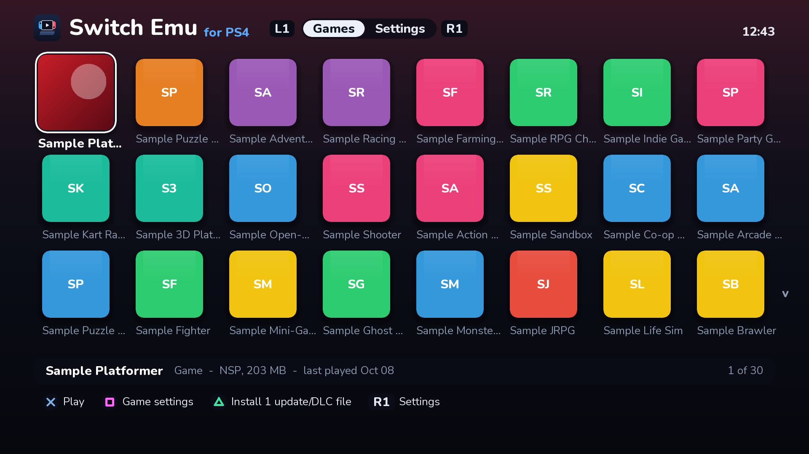
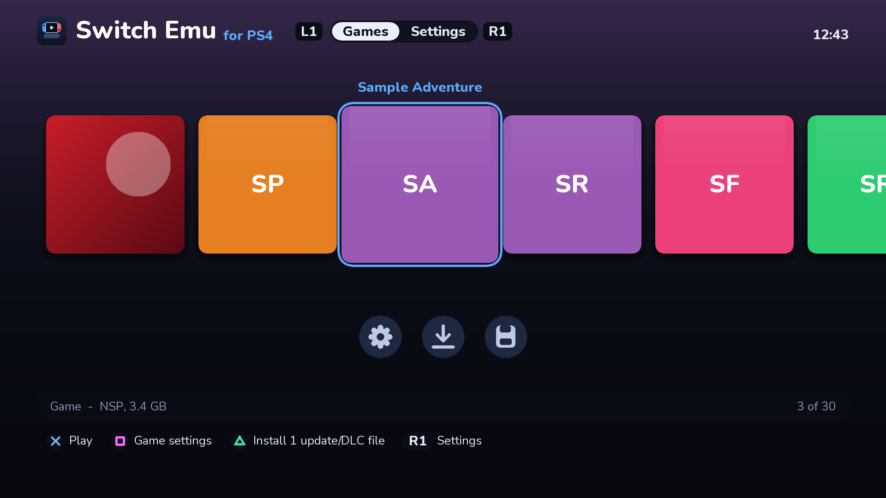
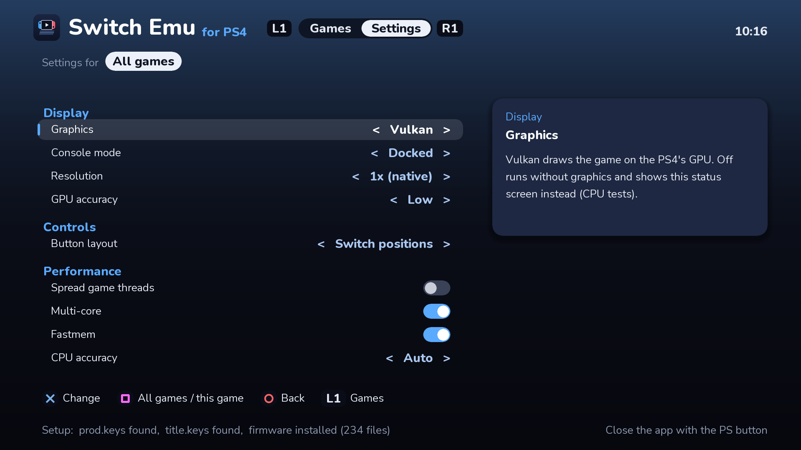
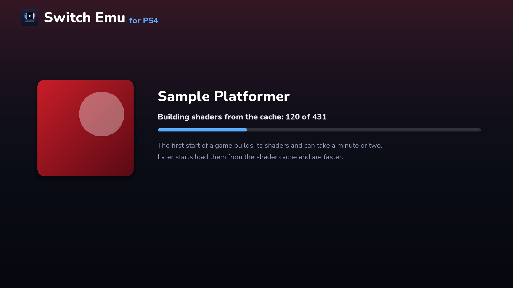
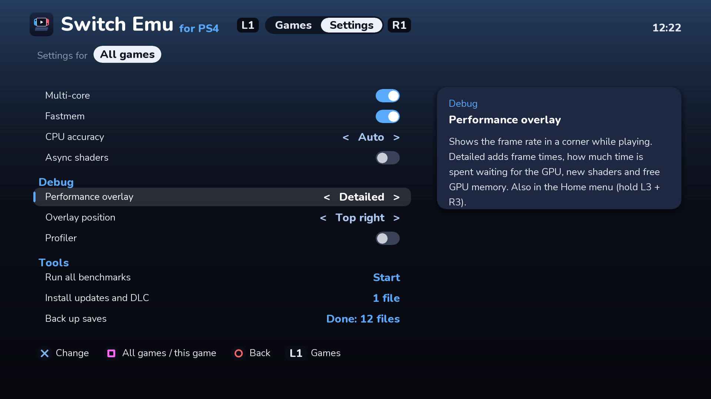
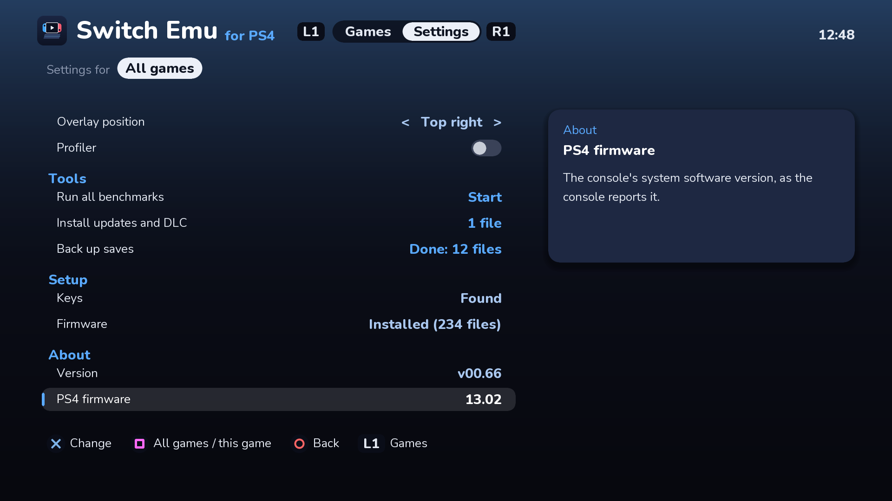
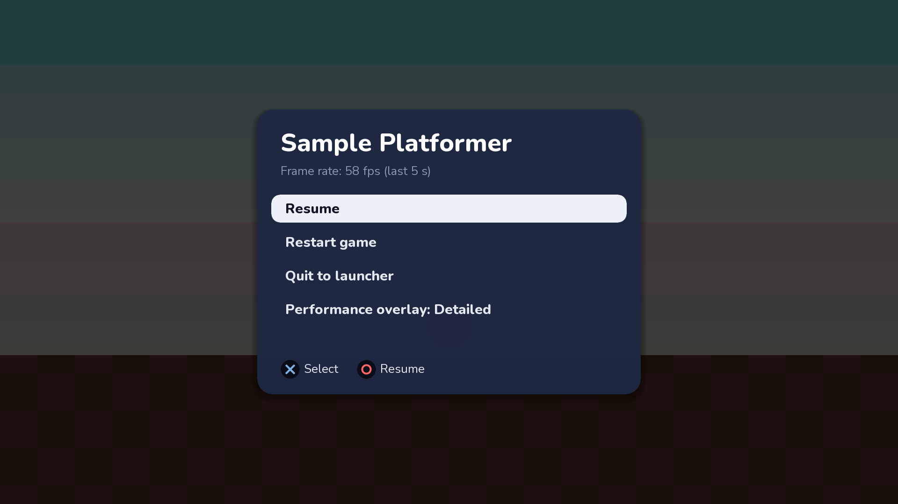
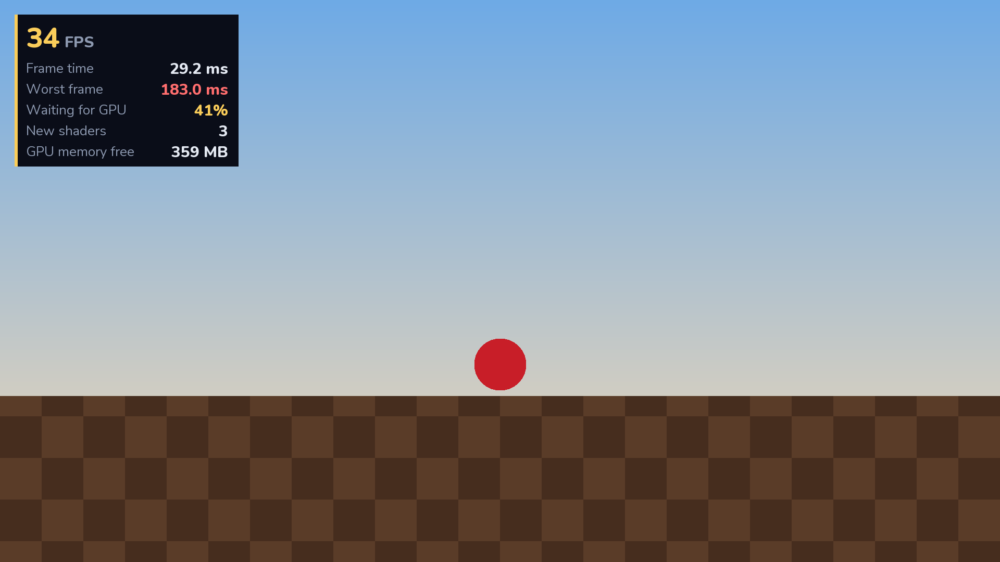

<p align="center"></p>

<h1 align="center">PS4 Switch Emu</h1>

A Nintendo Switch emulator that runs **natively on a jailbroken PS4**, installed as a `.pkg` and
played with a DualShock 4. It is a port of the [Eden](https://git.eden-emu.dev/eden-emu/eden)
emulator, with a console launcher built for the TV.

<p align="center">
  
  
</p>

> [!WARNING]
> **Experimental.** This is early work: a handful of games run, most are slow or untested, and
> crashes are expected. Treat it as a tech demo, not a finished emulator.

> [!IMPORTANT]
> **Unofficial, and not Eden.** This project was made with AI assistance, which the Eden project
> does not allow. It is not affiliated with or endorsed by the Eden team, Nintendo or Sony.
> **Please don't report problems to Eden**; use this repository's issues instead.

## Contents

- [What works](#what-works)
- [Game compatibility](COMPATIBILITY.md)
- [What you need](#what-you-need)
- [Installing](#installing)
- [Setting up your games](#setting-up-your-games)
- [Using it](#using-it)
- [Building from source](#building-from-source)
- [How it works](#how-it-works)
- [Credits and license](#credits-and-license)

## What works

| Area | Status |
|---|---|
| CPU | ARM64 games recompiled to x86-64 by dynarmic, multi-core, with fastmem |
| Graphics | Vulkan on the PS4's GPU (Mesa RADV); geometry and tessellation shaders are skipped, so some effects are missing |
| Audio | Yes |
| Controller | DualShock 4, with rumble, light bar, touchpad and motion |
| Saves | Yes, plus a one-button backup |
| Updates and DLC | Installable from the launcher |
| Performance | Light 2D games are playable (about 30-60 fps); heavier 3D games are largely untested and expected to be slow |

Which games have been tested, and how well they run: [COMPATIBILITY.md](COMPATIBILITY.md).

Tested on a PS4 Pro (firmware 13.02, GoldHEN). Other models and firmwares supported by GoldHEN
should work, but the base PS4 and PS4 Slim have a slower CPU and GPU and are untested.

## What you need

- **A jailbroken PS4** running [GoldHEN](https://github.com/GoldHEN/GoldHEN), with a way to copy
  files to it (GoldHEN's FTP server is easiest).
- **A modded Nintendo Switch you own**, to dump from it:
  - your **keys** (`prod.keys` and `title.keys`)
  - the Switch **firmware**
  - your **games**, as `.nsp` or `.xci` files

> This project does not include and will not provide keys, firmware or games. Dump them from your
> own console; requests for them will be closed.

Homebrew `.nro` files run without keys or firmware.

## Installing

1. Get the package `IV0000-SWEM00001_00-SWITCHEMU0000000.pkg`, either from the
   [Releases](../../releases) page when one is published or by [building it](#building-from-source).
2. Copy it to the PS4 (for example to `/data/pkg/`) and install it with GoldHEN's
   **Package Installer**.
3. Start **PS4 Switch Emu** from the PS4 home screen. The first start creates its folder,
   `/data/switch-emu/`, with everything below in place and a `README.txt` saying what goes where.

## Setting up your games

Copy these into the app's folders on the PS4 (over FTP, for example):

| What | Where |
|---|---|
| `prod.keys`, `title.keys` | `/data/switch-emu/keys/` |
| Firmware (the `.nca` files, loose) | `/data/switch-emu/nand/system/Contents/registered/` |
| Games (`.nsp`, `.xci`) and homebrew (`.nro`) | `/data/switch-emu/games/` |
| Updates and DLC (`.nsp`) to install | `/data/switch-emu/install/` |

Dump the keys **after** updating the Switch to the firmware you dump, so they are new enough for
it. **Settings → Setup** shows whether the keys and firmware were found.

## Using it

### Launcher

<p align="center">
  
  
</p>
<p align="center">
  
  
</p>

| Button | Games tab | Settings tab |
|---|---|---|
| D-pad | Move around the grid | Choose a setting |
| Cross | Play | Change the setting |
| Square | This game's own settings | Switch between all games and this game |
| Triangle | Install the updates/DLC waiting in `/data/switch-emu/install` | |
| L1 / R1 | Switch tabs | Switch tabs |
| Circle | | Back to Games |

Each game's name and icon are read from its file when the app starts (the first time only, so
later starts are quick). Recently played games move to the front.

The library comes in two layouts (**Settings → Display → Games layout**):

- **Grid:** 24 games at a time.
- **Console row:** one row of large tiles with the selected game's name above, like a console's
  home screen. **Down** reaches round shortcuts for Settings, installing updates and DLC, and
  backing up saves.

### Settings

| Section | Settings |
|---|---|
| Display | Graphics, Console mode (Docked / Handheld), Resolution, GPU accuracy, Games layout |
| Controls | Button layout (Switch positions, or Cross = A) |
| Performance | Spread game threads, Multi-core, Fastmem, CPU accuracy, Async shaders |
| Debug | Profiler, Performance overlay, Overlay position |
| Tools | Run all benchmarks, Install updates and DLC, Back up saves |
| Setup | Whether your keys and firmware were found, and where they go |
| About | The app's version and your PS4's firmware (include both in bug reports) |

Each setting has help text beside it. Settings can be set for all games, or for one game only
(press Square on a game). For a slow game, try **Console mode: Handheld** (720p instead of 1080p)
and **Spread game threads: On**.

### In game

- **Hold L3 + R3** (press both sticks) for about a second to open the **Home menu**: Resume,
  Restart game, Quit to launcher, and the performance overlay.
- The **performance overlay** (Settings → Debug) shows the frame rate in a corner of your choice,
  or a detailed panel with frame times, GPU load, shader builds and free memory.
- Close the emulator with the PS button like any PS4 app.

<p align="center">
  
  
</p>

### Saves

Saves live in `/data/switch-emu/nand/user/save/`. **Settings → Tools → Back up saves** copies them
all to `/data/switch-emu/save-backups/<date and time>/`. To restore a backup, copy its folders back.

### When something goes wrong

Everything the app logs goes in `/data/switch-emu/logs/`. Please attach these to bug reports:

| File | What's in it |
|---|---|
| `boot-trace.log` | How far startup got, plus frame-rate lines while playing |
| `emulator.log` | The emulator's own log |
| `crash.log` | Registers and code addresses, if it crashed |
| `radv-ps4.log`, `gpu-fault.txt`, `gpu-hang.txt` | GPU driver messages, and details if the GPU faulted or hung |
| `samples.log` | Profiler output, if Settings → Debug → Profiler is on |

## Building from source

Everything builds inside a container (Ubuntu 24.04 with clang 21 and the OpenOrbis PS4 toolchain),
so the computer you build on only needs Git and Docker or Podman.

| | |
|---|---|
| Fastest | An x86-64 Linux PC with Docker or Podman |
| Also works | macOS or Windows (WSL2) with Docker Desktop; much slower on Apple silicon (x86-64 emulation) |
| Disk | About 15 GB (container image plus build cache) |
| Memory | 16 GB recommended |

### 1. Get the code

```sh
git clone --recursive https://github.com/ps4-switch-emu/ps4-switch-emu.git
cd ps4-switch-emu
```

`--recursive` also fetches the two submodules: the emulator (`eden/`) and DolphinPS4
(`vendor/DolphinPS4/`). If you cloned without it, run `git submodule update --init`.

### 2. Build

Each step runs in the container through `docker/run.sh`. The first run builds the container image.

```sh
docker/run.sh scripts/setup-toolchain.sh   # PS4 sysroot: libc++ 21 and runtime (once)
docker/run.sh scripts/build-mesa.sh        # Vulkan driver for the PS4 GPU (once)
docker/run.sh scripts/build-eden.sh        # the emulator (re-run after changes)
docker/run.sh scripts/package-eden.sh 0.1.0   # a release; test builds use 00.NN
```

The package lands in `out/`. Build trees and downloads are kept in a container volume named
`edenps4-build`, so later builds only recompile what changed. `docker/run.sh` with no arguments
opens a shell in the container.

### Building on another machine

To build on a faster Linux machine over SSH while editing on this one, name it in
`build-host.env` (ignored by git) at the top of the project:

```sh
EDENPS4_HOST=my-build-pc          # anything ssh accepts: a host name, user@host or an ssh config entry
EDENPS4_FALLBACK_IP=100.64.0.10   # optional: a second address to try, e.g. over a VPN
```

The same commands then sync the project there, build, and copy `out/` back. Set
`EDENPS4_LOCAL=1` to build locally anyway.

### Test programs and tools

| | |
|---|---|
| `scripts/build-gfx-test.sh`, `build-gpu-test.sh`, `build-pad-test.sh`, `build-audio-test.sh`, `build-test-nro.sh` | Small Switch homebrew programs for checking graphics, 3D, the controller, audio and CPU speed on the PS4. Built with devkitPro's container into `out/*.nro` |
| `tools/ui-preview/run.sh` | Renders every launcher screen to PNG files on your computer (needs clang++); used for the screenshots here |
| `tools/menu-test/run.sh` | Scripted tests of the launcher's menu logic (needs clang++) |
| `tools/summarize-samples.py` | Turns `samples.log` from the profiler into a per-thread summary |

See [docs/DEVELOPMENT.md](docs/DEVELOPMENT.md) for debugging crashes and profiling.

## How it works

| Piece | What it does |
|---|---|
| Runtime | DolphinPS4's PS4 runtime: memory allocator, executable memory for the JIT, crash logging |
| CPU | Eden's dynarmic JIT, with fixes for the PS4's address layout. Guest memory sits in PS4 direct memory and is committed on first use |
| GPU | Mesa's RADV Vulkan driver running on the PS4's GNM interface (from DolphinPS4); frames go to the TV through VideoOut |
| Input and audio | SDL3 with a PS4 controller driver; audio through AudioOut |
| Launcher | Drawn by the CPU straight into the screen (`eden/externals/ps4sup/`), with no UI toolkit |

| Path | What |
|---|---|
| `eden/` | The emulator: Eden plus the PS4 port ([ps4-switch-emu-core](https://github.com/ps4-switch-emu/ps4-switch-emu-core)) |
| `vendor/DolphinPS4/` | [DolphinPS4](https://github.com/iHaiDeeZ/DolphinPS4): PS4 runtime, Mesa patch, toolchain scripts |
| `assets/` | The logo (`logo.svg`) and the PS4 icon (`icon.svg`) |
| `docker/` | Container image and `run.sh` |
| `cmake/ps4-eden.cmake` | CMake toolchain file for the PS4 |
| `scripts/` | Build and packaging steps |
| `tools/` | Test programs, launcher preview, menu tests, profiler summary |

## Credits and license

Built on the work of:

- [Eden](https://git.eden-emu.dev/eden-emu/eden) and [yuzu](https://github.com/yuzu-mirror/yuzu)
  before it, the emulator itself
- [DolphinPS4](https://github.com/iHaiDeeZ/DolphinPS4), whose PS4 runtime and Vulkan-on-PS4 work
  made this port possible
- [OpenOrbis](https://github.com/OpenOrbis/OpenOrbis-PS4-Toolchain) and PacBrew, the PS4 toolchain
- [Mesa](https://mesa3d.org/) (RADV), [SDL](https://libsdl.org/), [dynarmic](https://github.com/lioncash/dynarmic)
- [GoldHEN](https://github.com/GoldHEN/GoldHEN)
- [devkitPro](https://devkitpro.org/), for building the test programs

Licensed under the **GNU General Public License v3.0 or later** ([LICENSE](LICENSE)). The emulator
and DolphinPS4 keep their own licenses and copyright notices.

"Nintendo Switch" is a trademark of Nintendo, and "PlayStation" and "PS4" are trademarks of Sony
Interactive Entertainment. This project is not affiliated with either.
